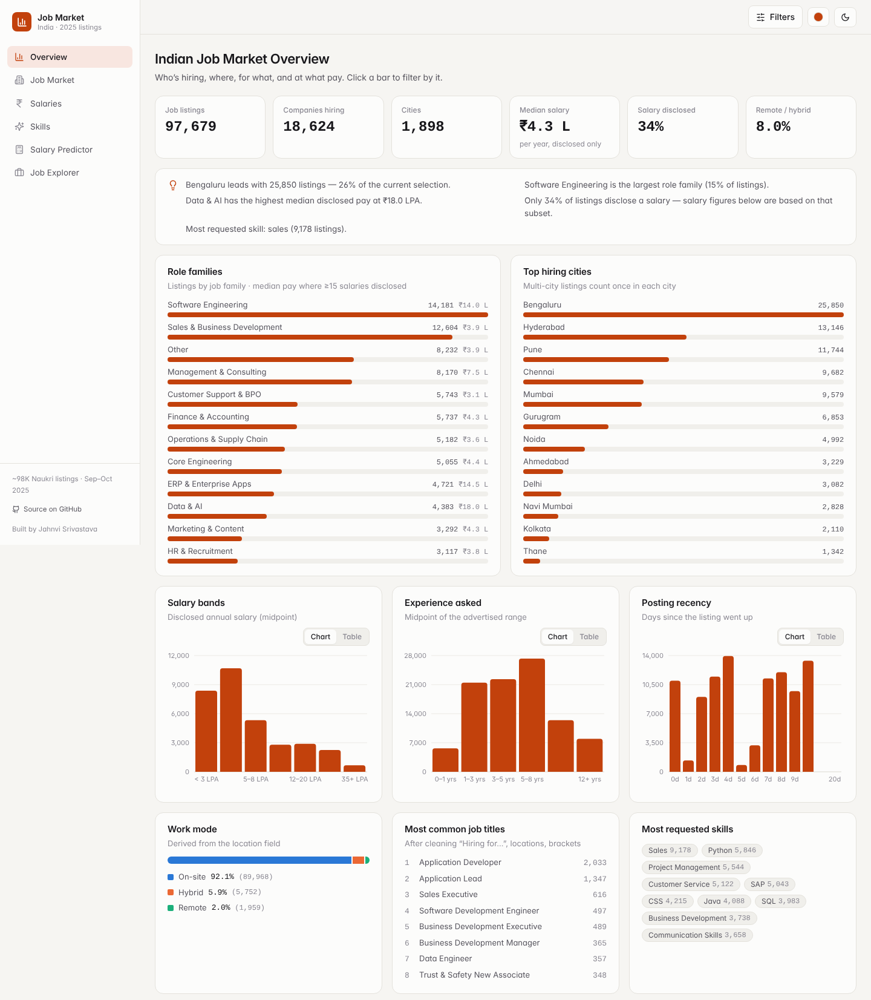
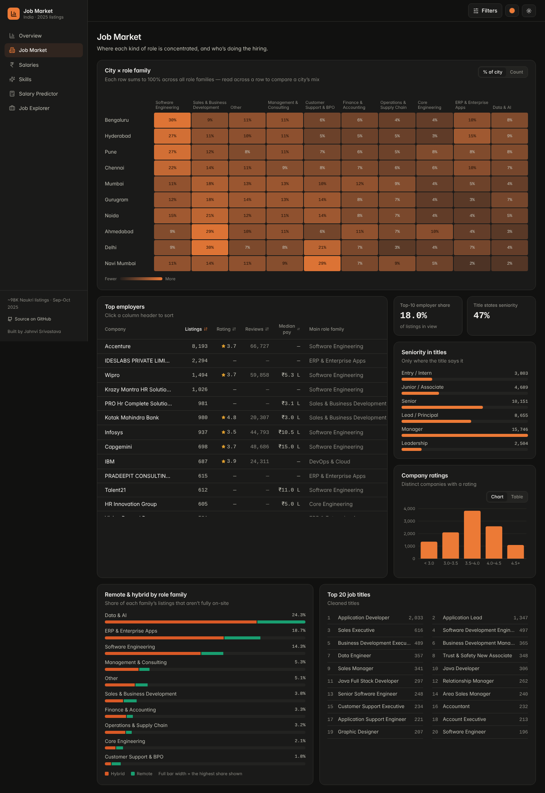
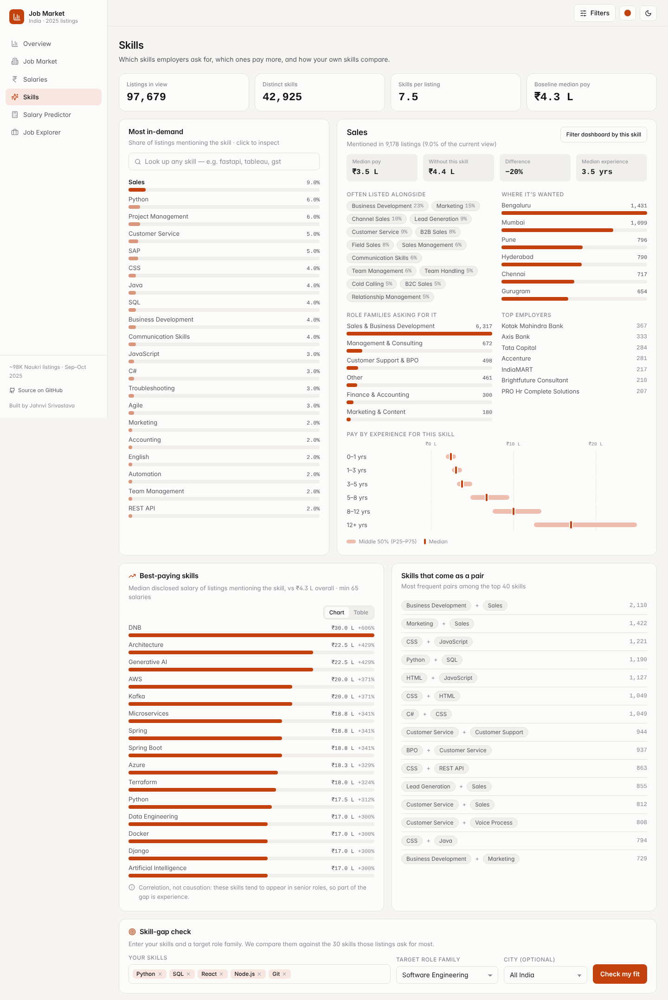
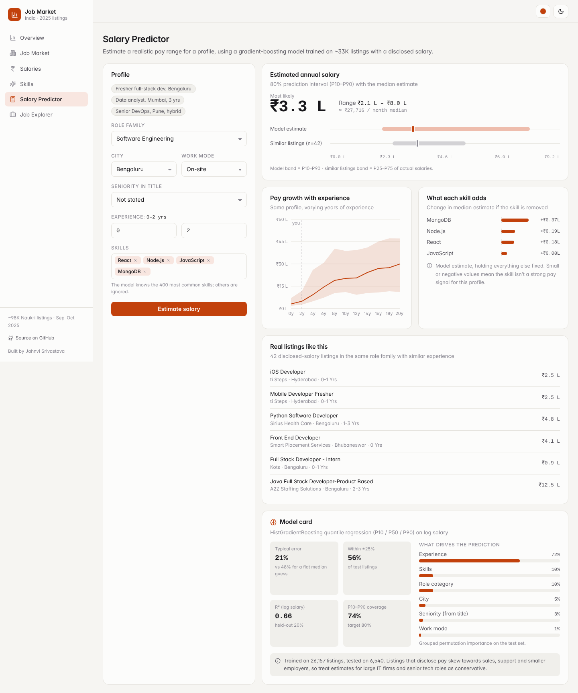

# Indian Job Market Intelligence

A full-stack analytics app built on **~98K Indian job listings** (Naukri, Sep–Oct 2025).
It covers who's hiring, where, for which roles, at what pay, which skills are in demand, and what salary a given profile can expect.

**Stack:** React · TypeScript · Vite · Tailwind · TanStack Query · Recharts — FastAPI · pandas · scikit-learn



<details><summary>More screenshots</summary>





</details>

> v1 of this project was a single-file Streamlit dashboard. It's kept in [`legacy/`](legacy/) for reference.

---

## What's inside

| Page | What it does |
|---|---|
| **Overview** | KPIs, auto-generated insights, role families with median pay, top cities, salary bands, experience asked, posting recency, work mode, top titles and skills. Click any bar to filter by it. |
| **Job Market** | City × role-family heatmap (counts or % of city), a sortable employer table (listings, rating, reviews, median pay), seniority mix, company rating spread, and remote/hybrid share by role family. |
| **Salaries** | P10–P90 percentiles, distribution, and interquartile ranges by experience, role family, city, seniority and work mode, plus the highest-paying listings. |
| **Skills** | Look up any of 42K skills to see its demand, pay with vs without it, commonly co-listed skills (with lift), cities, roles and employers. Also shows best-paying skills and the most common skill pairs. |
| **Skill-gap check** | Enter your skills and a target role family. You get a weighted demand-coverage score, how many listings strongly match you, and a ranked "learn next" list (demand × pay premium). |
| **Salary Predictor** | ML estimate of P10 / median / P90 pay for a profile, a pay-vs-experience curve, how much each skill adds, real comparable listings, and a model card. |
| **Job Explorer** | Full-text search over every listing, with sorting, pagination, a detail drawer (with pay vs peers) and **CSV export** of the current filtered view. |

Every page shares one **global filter set**: city, role family, experience, seniority, work mode, required skills, minimum company rating, and disclosed-salary-only. Filters are stored in the URL, so any view can be bookmarked or shared.

**UI:** a light/dark theme toggle (follows the OS by default) and four accent colours (Saffron, Blue, Emerald, Rose). Each chart has a **Chart / Table** toggle, and the layout works on phones.

---

## Data cleaning (what changed from v1)

The raw export has several problems that skewed v1's numbers. The pipeline ([`backend/app/pipeline.py`](backend/app/pipeline.py)) fixes them:

| Problem | Fix |
|---|---|
| `"Hyderabad, Chennai, Bengaluru"` and `"Kolkata(Chinar Park)"` counted as their own "locations" (10,066 unique) | Split multi-city strings, strip localities, normalise aliases (Bangalore→Bengaluru, Gurgaon→Gurugram, Mumbai Suburban→Mumbai…) |
| Remote/hybrid hidden inside the location text (`"Hybrid - Pune"`) | Extracted into a `workMode` field |
| Skill lookup used substring matching, so `java` also matched `javascript` | Skills tokenised into lists, alias-merged (`react.js`/`reactjs`→`react`), and matched exactly |
| 129 USD salaries mixed into INR stats; `0` and implausible values (a ₹500/yr midpoint, an ₹8.25 Cr one) treated as real | INR only; 0 → not disclosed; outside ₹60K–₹3 Cr → excluded |
| 55K free-text job titles | Rule-based classifier into 21 role families + seniority level parsed from the title; "Hiring for…", brackets and location suffixes stripped |
| `"6 Days Ago"` strings | Numeric posting age |
| 250 duplicate job IDs | Dropped |
| "Best-paying skills" dominated by one recruiter's repeated posts | A skill needs salaries from ≥10 companies, with no single company over 30% of them |

## Salary model

Three `HistGradientBoostingRegressor` quantile models (P10 / P50 / P90) trained on log salary for the ~33K listings that disclose pay. Features: role family, seniority, city (top 30), work mode, min/max experience, 400 most common skills (multi-hot).

| Metric (held-out 20%) | Value |
|---|---|
| Median absolute % error | **21%** (vs 48% for always guessing the median) |
| Predictions within ±25% | 56% |
| R² on log salary | 0.66 |
| P10–P90 interval coverage | 74% (target 80%) |

Grouped permutation importance: experience 72%, skills 10%, role family 10%, city 5%, seniority 3%, work mode 1%.

**Limitations:** listings that disclose pay skew towards sales, support and smaller employers (large IT firms rarely disclose), so estimates for senior tech roles are on the conservative side. The intervals are slightly too narrow.

---

## Run locally

**Requirements:** Python 3.10+, Node 18+

```bash
# 1. API (first start cleans the Excel file and trains the model, about 1–2 min)
cd backend
pip install -r requirements.txt
uvicorn app.main:app --reload --port 8000
# interactive API docs → http://localhost:8000/docs

# 2. Frontend (new terminal)
cd frontend
npm install
npm run dev
# → http://localhost:5173   (/api is proxied to :8000)
```

To rebuild the data or retrain the model by hand: `python -m app.pipeline` / `python -m app.ml`.

## Deploy

The frontend and API are deployed separately.

**API** (Render / Railway / any Python host, as a web service):

| Setting | Value |
|---|---|
| Root directory | `backend` |
| Build command | `pip install -r requirements.txt && python -m app.pipeline && python -m app.ml` |
| Start command | `uvicorn app.main:app --host 0.0.0.0 --port $PORT` |
| Env var | `CORS_ORIGINS=https://your-frontend.vercel.app` |

The API needs about 500 MB of RAM, so pick an instance with at least 1 GB.

**Frontend** (Vercel / Netlify):

| Setting | Value |
|---|---|
| Root directory | `frontend` |
| Build command | `npm run build` |
| Output directory | `dist` |
| Env var | `VITE_API_URL=https://your-api.onrender.com` |

Add a rewrite of all routes to `/index.html` (`frontend/vercel.json` already does this for Vercel) so links like `/skills` work on refresh.

Alternatively, run `npm run build` in `frontend/` before starting the API: FastAPI then serves the built site itself from one URL.

## API

| Endpoint | Description |
|---|---|
| `GET /api/meta` | Filter options, skill vocabulary, predictor inputs |
| `GET /api/overview` · `/market` · `/salary` · `/skills` | Aggregates for each page (all accept the filter query params) |
| `GET /api/skills/{name}` | Detail for one skill |
| `GET /api/skills/search?q=` | Skill autocomplete |
| `POST /api/skills/gap` | Skill-gap analysis `{skills, role, city?}` |
| `POST /api/predict` | Salary prediction `{roleCategory, seniority, city, workMode, expMin, expMax, skills}` |
| `GET /api/model` | Model card |
| `GET /api/jobs?q=&sort=&page=` · `/api/jobs/{id}` | Search / detail |
| `GET /api/export.csv` | Filtered CSV download |

Filter params: `cities`, `roles`, `exp`, `modes`, `seniority`, `skills` (pipe-separated, e.g. `cities=Pune|Mumbai`), `disclosed=true`, `minRating=4`.

## Project structure

```
backend/
  app/
    pipeline.py   raw Excel → cleaned parquet (cities, roles, skills, salary)
    ml.py         quantile salary model + model card
    data.py       in-memory store, filter masks
    main.py       FastAPI routes (+ serves the built frontend)
  data/           raw dataset (+ generated parquet / model)
frontend/
  src/
    pages/        Overview, Market, Salary, Skills, Predictor, Jobs
    components/   charts, inputs, layout, job drawer
    lib/          API client, URL-synced filters, theme
notebooks/        original exploratory analysis script
legacy/           v1 Streamlit app
```

## Author

**Jahnvi Srivastava** · [GitHub](https://github.com/jahnvisrivastava01)
